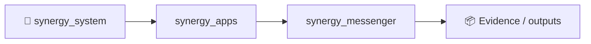
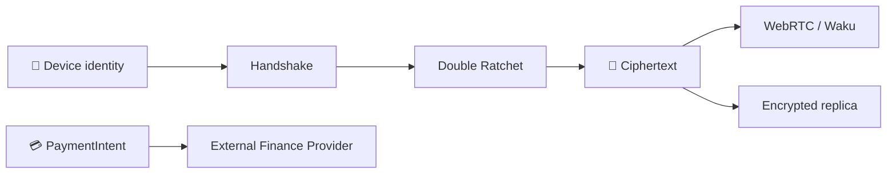

# SYNERGY Messenger V3

**Version:** `3.0.0-alpha.9`  
**Status:** final hardened alpha architecture  
**Model:** serverless/local-first P2P messenger — no mandatory central SYNERGY application server

SYNERGY Messenger V3 is a privacy-first messenger built around local durable state, direct WebRTC P2P transport, Waku-compatible decentralized fallback, Double Ratchet encrypted 1:1 sessions, MLS-oriented groups, encrypted resumable media/voice, a non-custodial Finance Bridge, Android hardening primitives, encrypted replicas, multi-device authorization, replay/rate-limit controls and local security maintenance.

> `alpha.9` is **not a production-security claim**. Independent cryptographic review, a real OpenMLS/WASM backend, cross-network physical-device tests and an official Android Gradle/APK/AAB build are still required before production deployment.

## Architecture

```text
UI / MessengerController
        |
        +----------------------+----------------------+-------------------+
        |                      |                      |                   |
   1:1 messaging          MLS groups          Media / Voice       Finance Bridge
        |                      |                      |                   |
 Double Ratchet        GroupCryptoProvider      AES-GCM chunks      PaymentIntent
        |                / OpenMLS boundary      + resume/hash       + explicit auth
        +----------------------+----------------------+-------------------+
                               |
                         Secure/P2P Core
                               |
                     durable outbox / inbox
                               |
                  +------------+-------------+
                  |                          |
            Direct WebRTC             Waku fallback
                  |                          |
                  +------------+-------------+
                               |
                        Local encrypted state
                     IndexedDB / Vault / Keystore
```

## Implemented phases

| Phase | Capability | Status |
|---|---|---|
| 1 | P2P Core, durable outbox/inbox, WebRTC + Waku abstraction, offline recovery | ✅ |
| 2 | Device identity, X3DH-style bootstrap, Double Ratchet, encrypted session state | ✅ |
| 3 | Real UI, local contacts, Public ID/QR, encrypted history, receipts, reply/forward, disappearing messages | ✅ |
| 4A | Encrypted resumable P2P media, chunk integrity, backpressure, retry/resume | ✅ |
| 4B | Private voice messages, Opus-first MediaRecorder flow, waveform, seek, speed control | ✅ |
| 4C | Decentralized MLS group orchestration, epochs, add/remove, roles, rotating mailbox, group media/voice | ✅ alpha |
| 4D | Non-custodial Finance Bridge, PaymentIntent, explicit authorization, verified receipts | ✅ |
| 5 | Android Keystore/native bridge/intent/FGS hardening source overlay | ✅ source/overlay |
| 6A | Encrypted decentralized media replica layer | ✅ |
| 6B | Account-root multi-device certificates, revocation, fan-out, logical dedupe | ✅ |
| 6C | Persistent replay guard, token-bucket rate limits, bounded MLS queues, cleanup and diagnostics | ✅ |

## Security invariants

- No mandatory central SYNERGY auth, messaging, history, group or media server.
- 1:1 application data is encrypted before entering the P2P transport layer.
- Ratchet/session state is sealed locally; private WebCrypto keys are created non-extractable where applicable.
- The legacy `js/crypto.js` file is retained only for provenance/reference and is intentionally excluded from the Capacitor runtime bundle.
- Group production runtime fails closed without a real RFC 9420-capable MLS backend; the deterministic MLS provider exists only under tests.
- Messenger never receives wallet private keys and exposes no generic raw signing API.
- Finance execution can only cross the injected `FinanceBridgeProvider.authorizeAndSubmit()` boundary after explicit user confirmation.
- Replica providers receive ciphertext only; local capability descriptors are Vault-sealed.
- Multi-device linking uses root-signed device certificates; the Account Root private key is non-extractable and is not copied to linked devices.
- Replay/rate-limit checks run before inbox/message persistence.
- `android.allowMixedContent` is disabled.

## Repository layout

```text
src/v3/
  core/          packet contracts and secure application payloads
  crypto/        identity, prekeys, handshake, Double Ratchet, vault/session state
  transport/     WebRTC, media WebRTC, Waku and hybrid routing
  sync/          durable inbox/outbox workers and sync engine
  storage/       IndexedDB repositories
  ui/            contacts, history, controller and QR/Public ID
  media/         encrypted media chunk protocol and repository
  voice/         MediaRecorder / waveform helpers
  groups/        MLS provider boundary, group service, policy and controller
  finance/       PaymentIntent/Receipt protocol and non-custodial provider boundary
  platform/      Android runtime/native security bridges
  replica/       encrypted replica capability/coordinator layer
  multidevice/   Account Root, device certificates, revocation and fan-out
  security/      ingress rate limit, replay guard, maintenance and diagnostics

tests/v3/        automated Phase 1–6 regression/security tests
docs/            architecture/design documents and implementation plans
native/          Android hardening overlay sources
scripts/         Capacitor copy/hardening scripts
www/             generated Capacitor web runtime
```

## Tests

The final `alpha.9` release gate completed with:

```text
249 tests
249 passed
0 failed
```

Run locally with a recent Node.js version:

```bash
npm test
```

The project currently uses Node's built-in test runner so the core test suite does not require Vitest.

## Web / PWA build

```bash
npm run build:www
```

`www/` is generated from the runtime allowlist. Tests, docs and the legacy crypto reference are not copied into the application runtime bundle.

## Android

Capacitor configuration:

- App ID: `ai.sinergy.messenger`
- App name: `Синергия-Мессенджер`
- Web directory: `www`
- Mixed content: disabled

Expected workflow on a machine with working npm and Android SDK:

```bash
npm install
npx cap add android        # first Android scaffold only
npm run android:prepare
npx cap open android
```

See [`CAPACITOR-ANDROID.md`](CAPACITOR-ANDROID.md) and the Phase 5 documentation before producing a release build.

The current repository contains the hardening source/overlay, but this environment did not produce or verify an APK/AAB because the official Capacitor Android scaffold could not be downloaded here.

## Waku runtime boundary

`@waku/sdk` is declared as a dependency and the transport adapter is implemented, but public Waku operation must still be validated with the locally bundled SDK on real devices/networks. The application does not silently switch to a CDN-hosted SDK.

## MLS boundary

Group orchestration is designed around RFC 9420 semantics through `GroupCryptoProvider` / `OpenMlsProvider`.

A deterministic provider is used only in automated tests and is excluded from `www/`. A real OpenMLS/WASM-compatible backend must be injected for production groups.

## Finance boundary

SYNERGY Messenger is not a custodial wallet. The chat layer creates encrypted payment intents and receipts; an external trusted Finance/Wallet capability is responsible for preview, user authorization, signing/execution, compliance policy and receipt verification.

No fake balance is displayed when the provider is absent.

## Documentation

Key documents:

- [`docs/superpowers/specs/2026-09-15-synergy-messenger-v3-architecture-design.md`](docs/superpowers/specs/2026-09-15-synergy-messenger-v3-architecture-design.md)
- [`docs/V3-P2P-CORE.md`](docs/V3-P2P-CORE.md)
- [`docs/V3-CRYPTO.md`](docs/V3-CRYPTO.md)
- [`docs/V3-PHASE3-UI.md`](docs/V3-PHASE3-UI.md)
- [`SYNERGY-MESSENGER-v3.0-PHASE4A-MEDIA-README.md`](SYNERGY-MESSENGER-v3.0-PHASE4A-MEDIA-README.md)
- [`SYNERGY-MESSENGER-v3.0-PHASE4B-VOICE-README.md`](SYNERGY-MESSENGER-v3.0-PHASE4B-VOICE-README.md)
- [`SYNERGY-MESSENGER-v3.0-PHASE4C-GROUPS-MLS-README.md`](SYNERGY-MESSENGER-v3.0-PHASE4C-GROUPS-MLS-README.md)
- [`SYNERGY-MESSENGER-v3.0-PHASE4D-FINANCE-README.md`](SYNERGY-MESSENGER-v3.0-PHASE4D-FINANCE-README.md)
- [`SYNERGY-MESSENGER-v3.0-PHASE5-ANDROID-HARDENING-README.md`](SYNERGY-MESSENGER-v3.0-PHASE5-ANDROID-HARDENING-README.md)
- [`SYNERGY-MESSENGER-v3.0-PHASE6-HARDENING-README.md`](SYNERGY-MESSENGER-v3.0-PHASE6-HARDENING-README.md)
- `docs/superpowers/specs/` — design specifications
- `docs/superpowers/plans/` — implementation plans

## Current production blockers

Before calling this production-ready, complete at minimum:

1. Build and integrate a real OpenMLS/WASM backend and run RFC/interoperability/security tests.
2. Run real Waku + WebRTC tests across multiple physical devices and independent networks (Wi‑Fi, 4G/5G, CGNAT, reconnect/offline/process-kill scenarios).
3. Generate the official Capacitor Android scaffold and complete Gradle release/APK/AAB verification on physical Android devices.
4. Perform an independent cryptographic/application security review.
5. Define a secure Account Root recovery strategy (recovery kit, hardware-backed migration or separately reviewed social recovery) without introducing a hidden master-key server.
6. Validate Finance providers, custody, KYC/AML/compliance and transaction-signing controls independently before live money movement.

## Release

Current source release: **`v3.0.0-alpha.9`**.

The release is intentionally labeled **alpha** despite the completed architecture and regression suite. Security-sensitive software should be promoted only after external verification of the remaining production boundaries above.


<!-- SYNERGY-FEDERATION-PASSPORT:START -->
---

## 🧭 SYNERGY federation passport

**Домен:** 💬 Messaging / communications  
**Архитектурный родитель:** [`synergy_apps`](https://github.com/Shtenco/synergy_apps)  
**Архитектурный корень:** [`synergy_system`](https://github.com/Shtenco/synergy_system)



### Документационный контракт

README должен показывать: проблему → архитектуру → реальные артефакты → проверку → ограничения → связи с федерацией. Сильные claims без evidence остаются R&D/CANDIDATE.

### Навигация

- [📚 Атлас всех 75 репозиториев](https://github.com/Shtenco/synergy_system/blob/main/docs/SYNERGY_REPOSITORY_ATLAS.md)
- [🧾 Машиночитаемый registry](https://github.com/Shtenco/synergy_system/blob/main/registry/SYNERGY_REPOSITORIES.json)
- [🧭 SYNERGY SYSTEM](https://github.com/Shtenco/synergy_system)

### Authority rule

Репозиторий не присваивает полномочия соседнего домена: AI ≠ authorization, UI ≠ ledger, blockchain commitment ≠ accounting truth, backtest ≠ realized external P&L.

<!-- SYNERGY-FEDERATION-PASSPORT:END -->

---

# 💬 Глубокий evidence-паспорт Messenger V3

## Release evidence

`RELEASE-MANIFEST.json` фиксирует:

```text
release: 3.0.0-alpha.9
file_count: 293
regression: 249/249 tests passed
security_status: final hardened alpha; not a production-security claim
```

Это хороший пример правильной эпистемической границы: regression gate подтверждает конкретный source release, но не заменяет независимый cryptographic audit.

## Security trust chain



## Production blockers как formal gates

| Gate | Что требуется |
|---|---|
| MLS | real RFC 9420/OpenMLS backend + interoperability tests |
| Network | multi-device physical WebRTC/Waku tests across independent networks |
| Android | official scaffold + signed APK/AAB + physical device verification |
| Crypto | independent security review |
| Recovery | reviewed Account Root recovery model |
| Finance | independent wallet/custody/compliance/signing validation |

## Что особенно важно сохранить

Messenger не должен получить raw wallet key или generic signing authority; Finance Bridge остаётся capability boundary.
